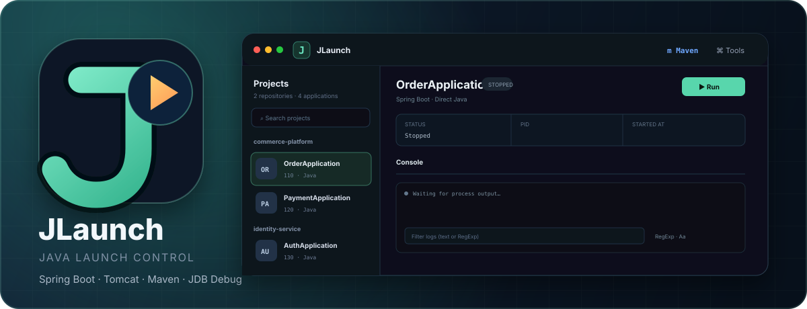

<p align="center">
  
</p>

<p align="center">
  <a href="https://github.com/LearnAIHubC/JLaunch/actions/workflows/ci.yml"></a>
  <a href="https://github.com/LearnAIHubC/JLaunch/releases/latest"></a>
  <a href="LICENSE"></a>
</p>

<p align="center"><strong>Launch and debug Java services without keeping a full IDE open.</strong></p>
<p align="center"><a href="README.md">简体中文</a> · English · <a href="https://github.com/LearnAIHubC/JLaunch/releases/latest">Latest release</a></p>

JLaunch is a lightweight desktop launchpad for Spring Boot, Maven multi-module projects, and Tomcat. Select a Maven root once and it discovers every runnable Spring Boot application below it. Run and Debug both use the selected JDK's `java` executable directly; Maven is used to resolve an IDEA-like classpath, not as the long-running application process.

JLaunch is an Electron-only desktop application. Settings stay in local SQLite—there is no backend, account, or remote database.

## Highlights

- Discover runnable Spring Boot applications while excluding library-only modules.
- Launch with `java -classpath ... MainClass`, `java -jar`, or managed Tomcat.
- Merge Maven runtime and compile scopes, including provided dependencies needed by WAR/JSP projects.
- Group applications by repository and start a repository in configured order.
- Attach the selected JDK's `jdb`, browse source as a directory tree, set line breakpoints, pause, and resume.
- Manage multiple JDK, Maven, and Tomcat installations globally or per project.
- Use a Maven tool window with module tree, Profiles, Lifecycle goals, cancellation, and logs.
- Keep memory bounded to the newest 2,000 lines per console, with text and regular-expression filters.

## Downloads

Download the latest build from [GitHub Releases](https://github.com/LearnAIHubC/JLaunch/releases/latest).

| Platform | Packages | Architectures |
| --- | --- | --- |
| macOS | DMG, ZIP | Apple Silicon, Intel |
| Windows | NSIS installer, portable EXE | x64 |

Public builds are currently unsigned. macOS may require **Right click → Open**, and Windows may show a SmartScreen warning. Every release includes SHA-256 checksums.

## Quick start

1. Open **Toolchains** and let JLaunch discover JDK, Maven, and Tomcat installations.
2. Add a directory containing a root `pom.xml`.
3. Run Maven `compile` once if the modules do not have `target/classes` yet.
4. Select an application and choose **Run** or **Debug**.

`$MODULE_WORKING_DIR$` resolves to each discovered application's own Maven module directory.

## Development

Requirements: Node.js 22+ and npm 10+.

```bash
npm ci
npm start
npm run check
npm run dist
```

See [Architecture](docs/ARCHITECTURE.md), [Contributing](CONTRIBUTING.md), and [Security](SECURITY.md) for more detail.

## License

[MIT](LICENSE) © 2026 JLaunch contributors
