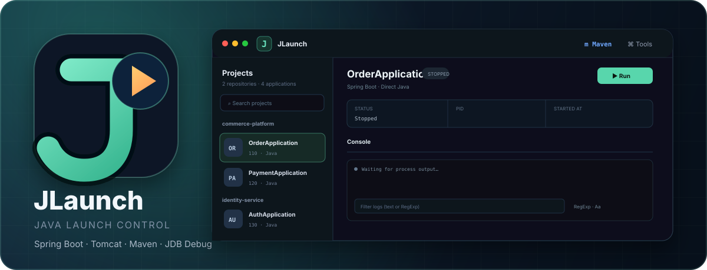
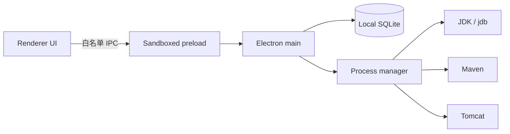

<p align="center">
  
</p>

<p align="center">
  <a href="https://github.com/LearnAIHubC/JLaunch/actions/workflows/ci.yml"></a>
  <a href="https://github.com/LearnAIHubC/JLaunch/releases/latest"></a>
  <a href="LICENSE"></a>
  
  
</p>

<p align="center">
  <strong>让 IDE 回归编辑器，让 Java 服务启动、编排和调试交给更轻的桌面工具。</strong>
</p>

<p align="center">
  简体中文 · <a href="README.en.md">English</a> · <a href="https://github.com/LearnAIHubC/JLaunch/releases/latest">下载最新版</a>
</p>

JLaunch 是一款面向 Spring Boot、Maven 多模块工程和 Tomcat 的轻量桌面运行器。它会自动识别根目录下所有可运行的 Spring Boot Application，以 `java -classpath ... 主类` 直接启动，并用 JDK 自带的 `jdb` 提供真实断点调试。应用只有 Electron 前端，配置保存在本机 SQLite，不需要独立后端、账号或远程数据库。

## 核心能力

| 能力 | 说明 |
| --- | --- |
| 自动发现 Application | 选择一个 Maven 根项目，一次识别所有可运行 Spring Boot 工程；普通库模块不会进入运行列表。 |
| 直接 Java 启动 | 普通运行与 Debug 都使用目标 JDK 的 `java`，不会把 `mvn spring-boot:run` 留作常驻进程。 |
| 多项目编排 | 工程按根项目分组，可单独启停，也可在项目组内按照启动顺序依次拉起。 |
| IDEA 风格 classpath | 合并 Maven `runtime + compile` 依赖，将 reactor 模块的 `target/classes` 放在依赖 JAR 前，并兼容 WAR 的 provided 依赖。 |
| 真实断点 Debug | 自动配置 JDWP、连接 JDK 自带 `jdb`，源码树中点击行号即可下断点，请求命中后定位并暂停。 |
| Maven 工具窗 | 浏览完整模块树、选择 Profile、执行 Lifecycle、停止任务并查看独立日志。 |
| 工具链管理 | 自动搜索或手动添加多个 JDK、Maven、Tomcat，每个工程可独立选择版本。 |
| 有界日志 | 项目和 Maven 控制台只保留最近 2,000 行，支持文本、正则、大小写逐行筛选。 |

## 下载

前往 [Releases](https://github.com/LearnAIHubC/JLaunch/releases/latest) 下载与你的平台匹配的文件：

| 平台 | 文件 | 架构 |
| --- | --- | --- |
| macOS | `.dmg` / `.zip` | Apple Silicon、Intel |
| Windows | Setup `.exe` / Portable `.exe` | x64 |

> 当前公开构建未进行 Apple Developer ID 或 Windows Authenticode 签名。macOS 首次启动请在 Finder 中右键选择“打开”；Windows 可能显示 SmartScreen 提示。源码和 SHA-256 校验文件会与安装包同时发布。

## 快速开始

### 1. 配置工具链

打开右上角“工具链”。JLaunch 会扫描 `JAVA_HOME`、`MAVEN_HOME`、`M2_HOME`、`CATALINA_HOME`、当前 `PATH`，以及 macOS、Windows、Linux、Homebrew、SDKMAN 等常见安装目录。未被发现的版本可手动选择安装根目录。

### 2. 添加 Maven 根项目

点击左侧 `+`，选择包含根 `pom.xml` 的目录。JLaunch 会遍历模块，只导入同时满足以下条件的工程：

- 存在 Spring Boot Maven 插件；
- 源码包含 `@SpringBootApplication`；
- 主类调用 `SpringApplication.run(...)`。

工程名称、主类、模块目录会自动填写。`$MODULE_WORKING_DIR$` 会在运行时解析成每个 Application 自己的 Maven 模块目录。

### 3. 编译并运行

直接 Java 启动要求模块已有 `target/classes`。首次运行前，可在 Maven 工具窗执行 `compile`。随后点击工程右侧“运行”或“Debug”。

```text
普通运行  JDK/bin/java -classpath <reactor classes + Maven dependencies> <MainClass>
Debug     JDK/bin/java -agentlib:jdwp=... -classpath ... <MainClass>
Tomcat    catalina run / catalina jpda run
```

## Debug 工作流

1. 为工程选择独立 Debug 端口；
2. 点击“Debug”，JLaunch 启动 Java 并自动连接 `jdb`；
3. 在源码树打开 Java 文件，点击行号设置断点；
4. 请求命中断点后，线程暂停并自动定位到对应源码行；
5. 点击“继续”恢复执行。

当前调试闭环聚焦断点与继续运行，不提供变量求值和单步执行。Debug 端口只监听回环地址。

## 架构与安全边界



- Renderer 禁用 Node 集成，开启 `contextIsolation`、sandbox 与 CSP；DevTools 和远程调试入口默认关闭。
- 源码读取验证真实路径，拒绝目录穿越和项目外符号链接。
- SQLite 使用 WAL 与事务；没有 HTTP 服务，不上传项目源码或运行日志。
- 环境变量以明文保存在本机 SQLite，请勿存放不应落盘的长期密钥。
- 应用退出时先优雅停止托管进程，超时后清理完整进程树。

更多细节见 [架构说明](docs/ARCHITECTURE.md) 与 [安全策略](SECURITY.md)。

## 本地开发

要求 Node.js 22+ 与 npm 10+。

```bash
npm ci
npm start
npm run check
```

生成当前平台安装包：

```bash
npm run dist
```

输出目录为 `release/`。Windows、macOS 安装包应在对应系统或 GitHub Actions runner 上构建。

## 参与贡献

欢迎提交 Bug、功能建议和 Pull Request。开始前请阅读 [CONTRIBUTING.md](CONTRIBUTING.md)。版本变化见 [CHANGELOG.md](CHANGELOG.md)。

## License

[MIT](LICENSE) © 2026 JLaunch contributors
