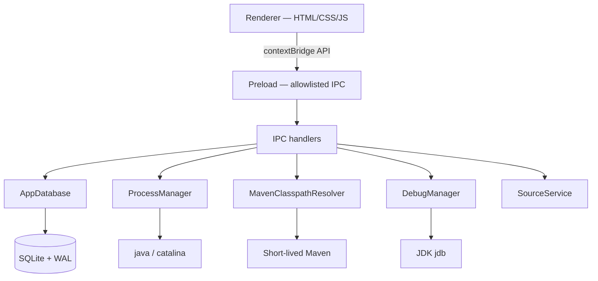

# JLaunch architecture

JLaunch deliberately keeps the runtime small: one Electron main process, one sandboxed renderer, local SQLite, and the Java/Maven/Tomcat processes explicitly started by the user. There is no HTTP backend.

## Process model

## Project discovery

The project inspector walks Maven modules from a selected root `pom.xml`. A module is added to the run list only when it has a Spring Boot Maven plugin and a source class containing both `@SpringBootApplication` and `SpringApplication.run(...)`. Library modules remain visible in the Maven tool window but do not become runnable applications.

## Direct Java launch

For a Maven application JLaunch builds an IDEA-style classpath:

1. locate the selected module's `target/classes`;
2. include other reactor modules' `target/classes` before repository JARs;
3. ask Maven Dependency Plugin for both runtime and compile classpaths;
4. de-duplicate paths while preserving order;
5. spawn the selected JDK's `java -classpath ... MainClass` without a shell.

Compile scope is intentionally included because Maven `provided` and `system` dependencies can be required by IDE-style application launches—for example embedded Jasper in a Spring Boot WAR.

## Debugging

Debug mode adds a JDK-version-compatible JDWP option to the same direct Java command. `DebugManager` starts the selected JDK's `jdb`, attaches to the loopback debug port, applies persisted breakpoints, parses pause locations, and exposes only set/clear breakpoint and resume operations to the renderer.

## Data model

SQLite stores project configurations, discovered toolchains, settings, arguments, profiles, environment variables, startup order, and debug ports. Schema upgrades run transactionally. Runtime logs and source documents are memory-only and bounded.

## Security boundaries

- Renderer Node integration is disabled; context isolation, sandbox, CSP, and web security are enabled.
- Preload exposes a narrow API. Every IPC handler returns a normalized success/error envelope.
- Commands use argument arrays with `shell: false`; user input is never concatenated into a shell command.
- Source paths are resolved and checked against the configured project roots, including symlink targets.
- DevTools shortcuts and the remote debugging switch are disabled in distributed builds.
- Shutdown attempts graceful termination, then kills the managed process tree after a timeout.
